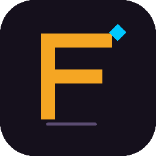

# ForgeMind

  

**ForgeMind** is an AI development toolchain for Unreal Engine: a C# MCP server exposes UE editor capabilities to AI clients via the [Model Context Protocol](https://modelcontextprotocol.io), with a C++ Companion plugin on the editor side.

## 📖 Documentation

Choose your preferred language:

- **[English](docs/en/README.md)**
- **[简体中文](docs/zh-CN/README.md)**
- **[繁體中文](docs/zh-HK/README.md)**
- **[日本語](docs/ja-JP/README.md)**
- **[한국어](docs/ko-KR/README.md)**
- **[Español](docs/es-ES/README.md)**
- **[Čeština](docs/cs-CZ/README.md)**
- **[Deutsch](docs/de-DE/README.md)**
- **[Français](docs/fr-FR/README.md)**
- **[Italiano](docs/it-IT/README.md)**
- **[Polski](docs/pl-PL/README.md)**
- **[Português](docs/pt-PT/README.md)**
- **[Русский](docs/ru-RU/README.md)**

## License

Proprietary — See [LICENSE](LICENSE) for details.
